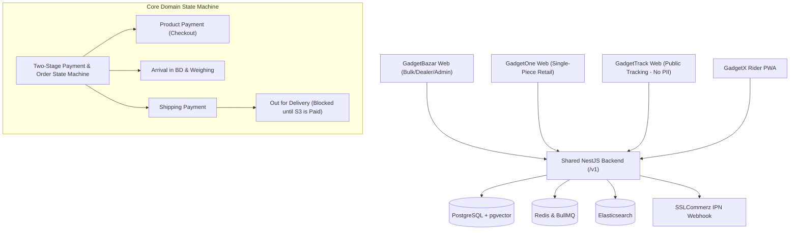

# GadgetBazar System Architecture

## Architectural Highlights

1. **Shared NestJS Backend**: Provides unified APIs under `/v1/` with Swagger documentation and automatic API client generation (`@gadgetbazar/api-client`).
2. **Four Specialized Next.js Frontends**:
   - `web-bazar`: Full bulk, dealer wholesale (KYC-gated), group deals, and admin dashboard.
   - `web-one`: Clean B2C retail; strictly no MOQ/dealer/group-deal elements.
   - `web-track`: Zero-PII public tracking service.
   - `web-x`: Rider PWA scoped strictly to the authenticated rider's assigned deliveries.
3. **Data Layer**:
   - PostgreSQL 16 with `pgvector` for product semantic/image embeddings.
   - Redis 7 for caching and BullMQ background task processing.
   - Elasticsearch 8 for faceted gadget catalog searches.
