# GadgetBazar Database Schema & ERD Documentation

This document defines the complete database architecture, Entity-Relationship Diagram (ERD), table specifications, indexing rationale, and constraint rules for the GadgetBazar PostgreSQL database (managed via Prisma ORM).

---

## 1. High-Level Architecture & Rules

- **Database Engine**: PostgreSQL 16+ with extensions (`uuid-ossp`, `pgvector`, `citext`).
- **Primary Keys**: UUID v4 (`@id @default(uuid()) @db.Uuid`).
- **Monetary Values**: `Decimal(12, 2)` — strictly never float/double.
- **Weight**: Non-negative integer grams (`Int`), never fractional kilograms.
- **Auditing & Timestamps**: Every table has `createdAt` (`DateTime @default(now())`). Mutable tables include `updatedAt` (`DateTime @updatedAt`).
- **Append-Only / Immutable Records**:
  - `ShipmentEvent`: Append-only audit trail of shipping events (`createdAt` only, no `updatedAt`).
  - `LoyaltyLedger`: Immutable ledger of customer point adjustments (`createdAt` only, no `updatedAt`).
  - `AuditLog`: Append-only system and admin action logs (`createdAt` only, no `updatedAt`).
- **Soft Deletion**: Explicit `deletedAt DateTime?` on `User`, `Order`, `Product`, and `Review`.
- **Two-Stage Payment Separation (NON-NEGOTIABLE)**:
  - `Order.product_payment_status`: Status for initial product sourcing payment.
  - `Order.shipping_payment_status`: Status for post-arrival actual weight & customs payment.
  - Two independent statuses on `Order`, never unified into a single status.
  - Orders can never transition to `out_for_delivery` unless `shipping_payment_status = PAID`.

---

## 2. Mermaid Entity-Relationship Diagram (26 Tables)

```mermaid
erDiagram
    users ||--o{ addresses : "has"
    users ||--o{ device_tokens : "registers"
    users ||--o{ orders : "places"
    users ||--o{ reviews : "writes"
    users ||--o{ wishlist_items : "saves"
    users ||--o{ loyalty_ledgers : "accrues"
    users ||--o| dealers : "operates_as"
    users ||--o| riders : "operates_as"
    users ||--o{ group_deal_participants : "joins"
    users ||--o{ image_search_logs : "searches"
    users ||--o{ warranty_claims : "files"
    users ||--o{ audit_logs : "triggers"

    categories ||--o{ categories : "subcategories"
    categories ||--o{ products : "contains"

    products ||--o{ product_variants : "has"
    products ||--o{ product_media : "displays"
    products ||--o{ order_items : "ordered_in"
    products ||--o{ group_deals : "featured_in"
    products ||--o{ dealer_price_tiers : "discounted_in"
    products ||--o{ reviews : "reviewed_in"
    products ||--o{ wishlist_items : "wishlisted_in"
    products ||--o{ image_search_logs : "matched_in"
    products ||--o{ warranty_claims : "claimed_in"

    orders ||--o{ order_items : "contains"
    orders ||--o{ payments : "paid_by"
    orders ||--o| installment_plans : "financed_with"
    orders ||--o| shipments : "fulfilled_by"
    orders ||--o{ shipment_events : "logged_events"
    orders ||--o| delivery_tasks : "dispatched_via"
    orders ||--o{ reviews : "reviewed_in"
    addresses ||--o{ orders : "ships_to"

    product_variants ||--o{ order_items : "chosen_variant"
    order_items ||--o{ warranty_claims : "warranted_in"

    shipments ||--o{ shipment_events : "tracks"

    group_deals ||--o{ group_deal_participants : "enlists"

    dealers ||--o{ dealer_documents : "verifies"
    dealers ||--o{ dealer_price_tiers : "eligible_for"

    riders ||--o{ delivery_tasks : "assigned_to"

    users {
        uuid id PK
        string email UK
        string phone UK
        string password_hash
        enum role
        enum kyc_status
        int loyalty_points
        datetime deleted_at
    }

    addresses {
        uuid id PK
        uuid user_id FK
        string recipient_name
        string phone
        string district
        string thana
        string street_address
        boolean is_default
    }

    device_tokens {
        uuid id PK
        uuid user_id FK
        string token UK
        string platform
        datetime last_seen_at
    }

    categories {
        uuid id PK
        string slug UK
        string name_bn
        string name_en
        uuid parent_id FK
        string image_url
    }

    products {
        uuid id PK
        string sku UK
        uuid category_id FK
        string title_bn
        string title_en
        decimal sourcing_price_cny "ADMIN ONLY"
        decimal retail_price_bdt
        decimal dealer_price_bdt
        int moq
        boolean single_piece_available
        decimal avg_shipping_rate_per_kg_bdt "ESTIMATE"
        int warranty_months
        boolean is_genuine_certified
        int estimated_weight_grams
        boolean is_active
        datetime deleted_at
    }

    product_variants {
        uuid id PK
        uuid product_id FK
        string name
        string sku_suffix
        decimal price_adjustment_bdt
        int stock
    }

    product_media {
        uuid id PK
        uuid product_id FK
        string url
        enum media_type
        int sort_order
    }

    orders {
        uuid id PK
        string order_number UK
        uuid user_id FK
        uuid address_id FK
        enum status
        enum product_payment_status
        enum shipping_payment_status
        decimal total_product_price_bdt
        decimal estimated_shipping_bdt
        decimal actual_shipping_bdt
        string idempotency_key_stage1 UK
        string idempotency_key_stage2 UK
        datetime deleted_at
    }

    order_items {
        uuid id PK
        uuid order_id FK
        uuid product_id FK
        uuid variant_id FK
        int quantity
        decimal unit_price_bdt
        int actual_weight_grams
        decimal calculated_shipping_charge
    }

    payments {
        uuid id PK
        uuid order_id FK
        int stage
        enum provider
        decimal amount
        string status
        string idempotency_key UK
        string transaction_id UK
        string sslcommerz_session_key
        json raw_webhook_payload
    }

    installment_plans {
        uuid id PK
        uuid order_id FK,UK
        decimal total_amount
        int installment_count
        int interval_days
        datetime next_due_at
    }

    shipments {
        uuid id PK
        uuid order_id FK,UK
        enum mode
        string tracking_code UK
        string origin_country
        string carrier_name
        enum current_status
    }

    shipment_events {
        uuid id PK
        uuid shipment_id FK
        uuid order_id FK
        enum status
        string location_city
        string description_bn
        datetime created_at
    }

    group_deals {
        uuid id PK
        uuid product_id FK
        int target_participants
        int current_participants
        decimal price_per_unit_bdt
        datetime deadline
        enum status
    }

    group_deal_participants {
        uuid id PK
        uuid deal_id FK
        uuid user_id FK
        int quantity
        datetime joined_at
    }

    dealers {
        uuid id PK
        uuid user_id FK,UK
        string business_name
        string trade_license_no
        enum kyc_status
        datetime approved_at
    }

    dealer_documents {
        uuid id PK
        uuid dealer_id FK
        string doc_type
        string file_key
    }

    dealer_price_tiers {
        uuid id PK
        uuid dealer_id FK
        uuid product_id FK
        decimal override_price_bdt
        int min_quantity
    }

    riders {
        uuid id PK
        uuid user_id FK,UK
        string vehicle_type
        float current_lat
        float current_lng
        boolean is_active
    }

    delivery_tasks {
        uuid id PK
        uuid rider_id FK
        uuid order_id FK,UK
        enum status
        datetime assigned_at
        datetime picked_up_at
        datetime delivered_at
        string proof_image_url
    }

    reviews {
        uuid id PK
        uuid user_id FK
        uuid product_id FK
        uuid order_id FK
        int rating
        string body_bn
        string body_en
        boolean is_verified
        datetime deleted_at
    }

    wishlist_items {
        uuid id PK
        uuid user_id FK
        uuid product_id FK
    }

    loyalty_ledgers {
        uuid id PK
        uuid user_id FK
        enum tx_type
        int points
        string reference_id
        datetime created_at
    }

    image_search_logs {
        uuid id PK
        uuid user_id FK
        string image_url
        uuid top_result_product_id FK
        datetime searched_at
    }

    warranty_claims {
        uuid id PK
        uuid user_id FK
        uuid product_id FK
        uuid order_item_id FK
        enum status
        string description_bn
        datetime resolved_at
    }

    audit_logs {
        uuid id PK
        uuid actor_id FK
        enum action
        string entity
        string entity_id
        json changeset
        string ip_address
        datetime created_at
    }
```

---

## 3. Table Groupings & Data Dictionary

### 3.1 Identity & Authentication

- **`users`**: Base credentials, multi-role (`Role`: CUSTOMER, DEALER, RIDER, ADMIN, WAREHOUSE_STAFF), KYC status, loyalty point aggregate balance, soft deletion support.
- **`addresses`**: User shipping addresses with district, thana, default selector, and postal codes.
- **`device_tokens`**: Push notification tokens (FCM/APNS) for mobile/web apps.

### 3.2 Catalogue & Merchandise

- **`categories`**: Adjacency list hierarchy (`parent_id`) with bilingual display names and slugs.
- **`products`**: Central merchandise entity. Contains confidential `sourcing_price_cny` (admin-only), `retail_price_bdt`, `moq`, `avg_shipping_rate_per_kg_bdt` (marked as estimate), and integer gram weight.
- **`product_variants`**: Stock-keeping units per SKU variant (e.g. Color, Storage).
- **`product_media`**: Multi-asset gallery with ordering and alt text.

### 3.3 Orders & Two-Stage Payments

- **`orders`**: Dual payment states (`product_payment_status` & `shipping_payment_status`), pricing breakdown, stage 1 & 2 idempotency keys.
- **`order_items`**: Line items with final unit price, recorded actual weight upon BD arrival (`actual_weight_grams`), and final calculated shipping cost.
- **`payments`**: Raw transaction ledger. Differentiates stage 1 vs 2, SSLCommerz transactions, and preserves immutable raw webhook payloads.
- **`installment_plans`**: EMI / split installment payment arrangements.

### 3.4 Logistics & Delivery

- **`shipments`**: Cross-border freight tracking record with tracking number and mode (AIR vs SEA).
- **`shipment_events`**: Append-only status transitions (`ShipmentStatus`).
- **`riders`**: Domestic last-mile delivery personnel with geo-coordinates and vehicle classification.
- **`delivery_tasks`**: Order assignment to riders with delivery proof signed URL reference.

### 3.5 Group Deals (Atomicity & Concurrency)

- **`group_deals`**: Bulk purchase campaigns with target participant count, campaign discount, and strict deadline.
- **`group_deal_participants`**: Atomic joins ensured via `UNIQUE(deal_id, user_id)`.

### 3.6 Wholesale / Dealer Network

- **`dealers`**: Business entity linked to user account with trade license information.
- **`dealer_documents`**: Private KYC files (NID, Trade License, Bank Solvency) stored via non-public storage keys.
- **`dealer_price_tiers`**: Tiered product pricing overrides per dealer/product combination.

### 3.7 Engagement, Loyalty & Post-Sale

- **`reviews`**: Ratings and bilingual reviews with soft-delete capability.
- **`wishlist_items`**: Saved items per user (`UNIQUE(user_id, product_id)`).
- **`loyalty_ledgers`**: Immutable balance audit trail for earn/redeem transactions.
- **`image_search_logs`**: Sourcing visual search lookup log for similarity queries.
- **`warranty_claims`**: Post-delivery repair/replacement tracking tied to specific line items.
- **`audit_logs`**: Append-only compliance log capturing mutation diffs across entities.

---

## 4. Indexing Rationale

| Index                                | Target Table      | Purpose                                                                 |
| ------------------------------------ | ----------------- | ----------------------------------------------------------------------- |
| `@@index([order_id, created_at])`    | `shipment_events` | Fast chronological lookup of tracking events on public tracking page.   |
| `@@index([shipment_id, created_at])` | `shipment_events` | Shipment-level timeline resolution without scanning full table.         |
| `@@index([status, deadline])`        | `group_deals`     | Critical for cron worker expiring passed deals and active deal queries. |
| `@@index([rider_id, status])`        | `delivery_tasks`  | Enables instantaneous task list resolution for rider PWA app.           |
| `@@index([user_id, status])`         | `orders`          | High-frequency customer order history pagination and filtering.         |
| `@@index([category_id, is_active])`  | `products`        | Catalogue browsing by category with active product filter.              |

---

## 5. Constraint & Foreign Key Deletion Strategies

- **`Cascade`**: Child data lifecycle bounded by parent lifecycle:
  - User → Addresses, DeviceTokens, Reviews, WishlistItems, LoyaltyLedgers, Dealer, Rider.
  - Order → OrderItems, Payments, InstallmentPlans, Shipments, ShipmentEvents.
  - GroupDeal → GroupDealParticipants.
  - Dealer → DealerDocuments, DealerPriceTiers.
- **`Restrict`**: Protects financial and logistical referential integrity:
  - Product cannot be deleted if referenced in Orders, GroupDeals, or DealerPriceTiers.
  - Order cannot be deleted if linked to Rider DeliveryTasks.
- **`SetNull`**: Soft references where entity removal preserves historical context:
  - User removal retains AuditLog records (`actor_id = NULL`).
  - Category deletion preserves subcategories (`parent_id = NULL`).
